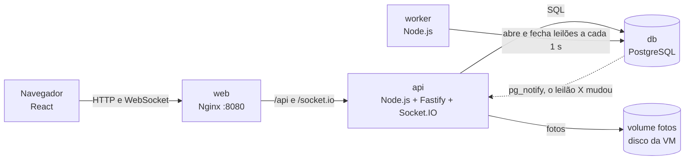
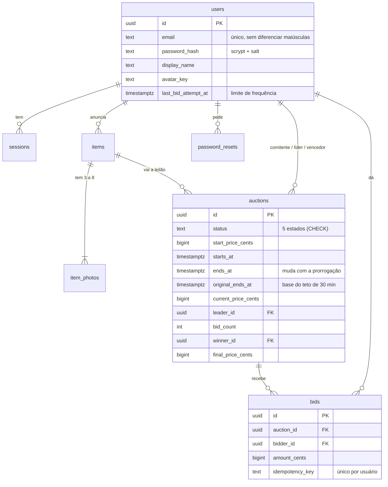
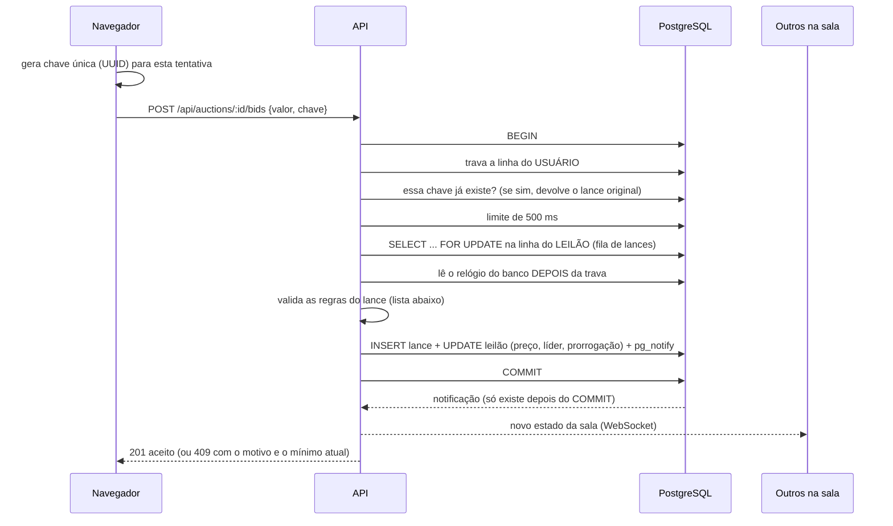

# Guia do código — para responder a banca

Feito para o time estudar em ~20 minutos. A banca pode chamar **qualquer um** para explicar o código e as decisões.
Detalhes de cada decisão (com alternativas e custos) estão em [DECISOES.md](DECISOES.md); o contrato da API, em [API.md](API.md).

**Sumário:** [1. Arquitetura](#1-arquitetura-em-1-minuto) · [2. Onde está cada coisa](#2-onde-está-cada-coisa) · [3. Banco de dados](#3-modelo-do-banco) · [4. O caminho de um lance](#4-o-caminho-de-um-lance-o-coração-do-sistema) · [5. Tempo e reinício](#5-abertura-fechamento-e-reinício) · [6. Tempo real](#6-tempo-real) · [7. Perguntas prováveis](#7-perguntas-prováveis-da-banca) · [8. Como estudar](#8-como-estudar-em-20-minutos)

---

## 1. Arquitetura em 1 minuto



> **Frase pronta:** "São quatro contêineres no Docker Compose. O Nginx é a única porta exposta da VM: serve o React e repassa a API e o WebSocket. A API cuida de login, leilões e lances; um worker separado abre e fecha leilões pelo relógio do banco; e o PostgreSQL é quem garante a consistência, com trava de linha, e avisa as mudanças com `pg_notify`. Sobe tudo com `./rodar.sh`."

---

## 2. Onde está cada coisa

| Pergunta | Arquivo | O que olhar |
|---|---|---|
| Como é o banco? | [api/src/migrate.ts](../api/src/migrate.ts) | constante `SCHEMA` (SQL puro) |
| Como um lance é processado? | [api/src/auctions.ts](../api/src/auctions.ts#L419) | `placeBidTx`, passos 1 a 6 comentados |
| Como abre e fecha sozinho? | [api/src/auctions.ts](../api/src/auctions.ts#L494) e [api/src/worker.ts](../api/src/worker.ts) | `runScheduler` |
| Regras de cálculo (incremento, prorrogação, máscara do nome) | [api/src/rules.ts](../api/src/rules.ts) | funções puras, sem banco |
| Editar, cancelar e relistar | [api/src/auctions.ts](../api/src/auctions.ts#L195) | `cancelAuction`, `editAuction`, `relistAuction` |
| Tempo real e presença na sala | [api/src/realtime.ts](../api/src/realtime.ts) | `LISTEN`, `room:join`, `isParticipant` |
| Login, sessão, senha | [api/src/auth.ts](../api/src/auth.ts) e [api/src/routes/auth.ts](../api/src/routes/auth.ts) | `hashPassword`, `userFromToken` |
| Fotos | [api/src/storage.ts](../api/src/storage.ts) | `detectImage` (valida pelo conteúdo) |
| Limites configuráveis | [api/src/config.ts](../api/src/config.ts) | tudo vem de variáveis de ambiente |
| Sala do leilão (front) | [web/src/pages/AuctionPage.tsx](../web/src/pages/AuctionPage.tsx) | `BidForm`, entrada na sala |
| Subir o projeto | [rodar.sh](../rodar.sh) e [docker-compose.yml](../docker-compose.yml) | |
| Provar que funciona | [api/scripts/](../api/scripts) | `verificar.ts`, `verificar-nivel2.ts`, `verificar-conta.ts` |

---

## 3. Modelo do banco

Arquivo: [api/src/migrate.ts](../api/src/migrate.ts). Não usamos ORM: é SQL escrito à mão, executado quando a API sobe. Como tudo usa `IF NOT EXISTS`, rodar de novo não apaga nada.



As tabelas `sessions`, `password_resets` e `email_outbox` (a caixa de saída simulada) completam o esquema.

**O banco garante as regras sozinho, mesmo com requisições simultâneas:**

| Regra | Como | Requisito |
|---|---|---|
| Só 5 estados | `CHECK (status IN (...))` | RN01 |
| Um e-mail, uma conta | índice único em `lower(email)` | RF01 |
| O mesmo lance reenviado não duplica | índice único `(bidder_id, idempotency_key)` | RF12 |
| Um item nunca tem 2 leilões ativos | índice único **parcial** `... WHERE status IN ('SCHEDULED','LIVE')` | RF28 |

**Escolhas do modelo:**
- **Item separado de leilão:** um item pode ser relistado; o leilão novo é outra linha, e o antigo continua no histórico.
- **Dinheiro em centavos (`BIGINT`):** R$ 10,50 vira `1050`, sem erro de arredondamento (RF19).
- **Horários em `TIMESTAMPTZ` (UTC):** a tela converte para o fuso de quem vê (RF19).
- **O leilão guarda preço atual, líder e total de lances:** para validar um lance basta ler e travar **uma linha**. A tabela `bids` é o histórico.

---

## 4. O caminho de um lance (o coração do sistema)



**As regras validadas, nesta ordem** (RF10): o leilão está em andamento · ainda não passou do término (relógio do banco) · quem dá o lance não é o comitente · está na sala como participante · não é o líder atual · o valor é maior ou igual ao lance mínimo **de agora**. Toda recusa informa o motivo e o lance mínimo atual.

No código, os passos estão numerados nos comentários de [`placeBidTx`](../api/src/auctions.ts#L419).

> **Frase pronta:** "Cada lance roda numa transação que trava a linha do leilão com `SELECT ... FOR UPDATE`. Lances simultâneos no mesmo leilão entram numa fila do próprio Postgres e são processados um de cada vez, na ordem de chegada. A validação usa o lance mínimo vigente **naquele instante** e o relógio do banco lido **depois** da trava. A sala só fica sabendo pelo `pg_notify`, que o Postgres só entrega depois do COMMIT."

---

## 5. Abertura, fechamento e reinício

[`runScheduler`](../api/src/auctions.ts#L494), chamado pelo [worker](../api/src/worker.ts) a cada 1 segundo, roda dois `UPDATE` condicionais:

```sql
UPDATE auctions SET status = 'LIVE' WHERE status = 'SCHEDULED' AND starts_at <= clock_timestamp();
UPDATE auctions SET status = CASE WHEN bid_count > 0 THEN 'SOLD' ELSE 'ENDED_NO_BIDS' END, ...
 WHERE status = 'LIVE' AND ends_at <= clock_timestamp();
```

- **Nada fica em memória:** depois de um reinício, o primeiro ciclo abre e fecha tudo o que ficou para trás (RF18).
- **Fechar duas vezes não duplica:** o segundo `UPDATE` não encontra mais `status = 'LIVE'`.
- **Fechamento e lance não se atropelam:** os dois disputam a mesma trava de linha. Se um lance está sendo gravado, o fechamento espera e reavalia `ends_at`, que pode ter sido prorrogado. Um lance que chega depois do fechamento vê `status ≠ LIVE` e é recusado.
- **Nenhum lance é aceito depois do horário,** mesmo que o worker atrase: o próprio lance compara com `ends_at` usando o relógio do banco.

---

## 6. Tempo real

- Mudanças no banco fazem `pg_notify('auction_events', id)`. A API escuta (`LISTEN`), **lê o estado atual no banco** e envia `auction:state` para todos na sala ([realtime.ts](../api/src/realtime.ts)).
- **Reconexão (RF24):** o Socket.IO reconecta sozinho; ao voltar, o front entra de novo na sala e recebe o estado completo. Não há eventos para "reconstruir".
- **Presença (RF25):** a API guarda quem está em cada sala e em que modo. O comitente só assiste. Lance só é aceito de quem está na sala como participante.
- **Aviso de lance superado (RF26):** a mesma transação do lance faz `pg_notify('user_events', ...)` para o líder anterior, que recebe o aviso em qualquer página.
- **Relógio na tela:** a contagem regressiva é só visual. O front calcula a diferença entre o relógio do servidor (`serverNow`) e o do navegador.

---

## 7. Perguntas prováveis da banca

### Concorrência (o centro do desafio)

**Dois usuários dão o mesmo lance no mesmo instante. O que acontece?**
O primeiro a obter a trava da linha do leilão é aceito. O segundo, quando chega a vez dele, já vê o preço novo, e o valor fica abaixo do mínimo: é recusado com o motivo e o mínimo atual. O script de verificação dispara 8 lances iguais ao mesmo tempo e confere que só 1 é aceito.

**E se o lance chega no mesmo instante em que o leilão fecha?**
O lance e o fechamento disputam a mesma trava de linha. Quem trava primeiro ganha: se for o lance (antes do horário), ele é gravado e pode até prorrogar o término; se for o fechamento, o lance vê o leilão encerrado e é recusado. Nunca existe lance aceito depois do fechamento.

**Clique duplo ou rede caindo: vira dois lances?**
Não. O navegador gera uma chave única por tentativa e reenvia a mesma chave. Se ela já existe, a API devolve o lance original (HTTP 200 em vez de 201). Há também um índice único no banco como segunda proteção. Duas cópias simultâneas são serializadas pela trava da linha do usuário.

**Como impedem uma rajada de lances?**
No mínimo 500 ms entre tentativas do mesmo usuário, controlado no banco (`last_bid_attempt_at`). Um reenvio legítimo da mesma chave é respondido antes dessa checagem e nunca é punido.

**A sala pode mostrar um lance que não foi gravado?**
Não. O aviso é um `pg_notify` dentro da transação, e o Postgres só entrega notificações depois do COMMIT.

**Funciona com mais de uma instância da API?**
Lances, fechamento e avisos funcionam, porque toda a coordenação está no Postgres. A exceção é a presença na sala, que fica na memória da instância: com várias instâncias, ela iria para o Redis ou para uma tabela. Está registrado como limitação conhecida.

### Tempo

**Qual relógio vale?**
O do banco (`clock_timestamp()`). A contagem na tela é só visual; um lance que chega depois do término é recusado, mesmo que o navegador ainda mostre segundos.

**E se o sistema reiniciar no meio de um leilão?**
O worker não guarda nada em memória. Ao voltar, o primeiro ciclo abre e fecha o que estiver atrasado. Os contêineres usam `restart: unless-stopped`. Testamos derrubando o worker com um leilão vencido (fechou como Vendido ao voltar) e reiniciando todos os contêineres na VM; a VM também foi reiniciada pela organização e o sistema voltou sozinho.

**Como funciona a prorrogação?**
Um lance que deixe menos de 2 minutos no relógio leva o término para 2 minutos depois dele, com no máximo 30 minutos acumulados além do término original (`original_ends_at`). Os valores ficam em variáveis de ambiente.

### Regras e dados

**Como é calculado o lance mínimo?**
Sem lances, é o preço inicial. Com lances, é o preço atual mais o incremento da faixa (R$ 1 até R$ 99,99 … R$ 500 a partir de R$ 25 mil), a tabela do edital. É calculado só no servidor ([rules.ts](../api/src/rules.ts)).

**Por que dinheiro em centavos?**
Inteiros não têm erro de arredondamento. Só a tela formata para R$.

**O comitente pode cancelar um leilão que acabou de receber lance?**
O cancelamento é um único `UPDATE ... WHERE bid_count = 0`. Se um lance entrar no mesmo instante, a trava de linha decide: ou o lance entra e o cancelamento falha, ou o contrário. Cancelar nunca apaga nada.

**Por que Postgres com SQL à mão, sem ORM?**
As garantias centrais dependem de recursos do Postgres (`FOR UPDATE`, `UPDATE` condicional, `clock_timestamp()`, `pg_notify`, índice parcial). Com o SQL à vista, mostramos exatamente onde cada garantia mora.

### Segurança

**Como guardam senhas e sessões?**
Senhas com `scrypt` e um salt por usuário. A sessão é um token aleatório num cookie `httpOnly` (o JavaScript da página não lê); no banco fica só o hash dele. Expira após 2h sem uso e se renova com o uso.

**E upload malicioso?**
A foto é validada pelos primeiros bytes do arquivo, não pela extensão. O nome é gerado pelo servidor e a rota de fotos só aceita nomes nesse formato, então não dá para ler outros arquivos do servidor.

**Como funciona o "esqueci minha senha"?**
Link de uso único, válido por 30 minutos. O banco guarda só o hash do token. A resposta é a mesma exista ou não a conta, para não revelar e-mails cadastrados. Ao redefinir, todas as sessões caem. O e-mail é simulado: fica numa caixa de saída que só o operador vê (`./rodar.sh emails`).

### Fotos

**Onde ficam as fotos?**
No disco da VM, num volume do Docker. O documento original pedia armazenamento em nuvem, mas o requisito foi corrigido para guardar na VM. O código para S3 continua pronto: basta `STORAGE_DRIVER=s3` com as credenciais.

### O que ficou de fora (item 3 do pitch)

- **Bônus de pontuação, habilitação de comitente e crédito** (RF29–RF32).
- **HTTPS com domínio:** a organização expõe só HTTP numa porta.
- **Presença na sala compartilhada entre instâncias:** hoje fica em memória.
- **E-mail de verdade:** simulado, com a troca isolada numa função.
- **Limpeza de fotos que deixaram de ser usadas.**

### Como provam que funciona?

Três scripts que imitam o navegador, inclusive o WebSocket, com **81 verificações** no total: Núcleo (22), Nível 2 (33) e conta (26). Rodam com `./rodar.sh verificar` ou direto pelo `npx tsx`.

---

## 8. Como estudar em 20 minutos

1. **Todos (5 min):** leiam as três "frases prontas" (seções 1 e 4) e a lista "o que ficou de fora".
2. **Cada um aprofunda uma parte (10 min)**, sugestão de divisão:
   - **Renan:** concorrência e tempo ([`placeBidTx`](../api/src/auctions.ts#L419) e [`runScheduler`](../api/src/auctions.ts#L494)).
   - **Gustavo:** tempo real e front ([realtime.ts](../api/src/realtime.ts), [AuctionPage.tsx](../web/src/pages/AuctionPage.tsx)).
   - **Francini:** banco, fotos, conta e deploy ([migrate.ts](../api/src/migrate.ts), [storage.ts](../api/src/storage.ts), [routes/auth.ts](../api/src/routes/auth.ts), [rodar.sh](../rodar.sh)).
3. **Rodada de perguntas (5 min):** um lê uma pergunta da seção 7 e outro responde **sem olhar**. Troquem até todos terem respondido sobre a parte de outra pessoa.
